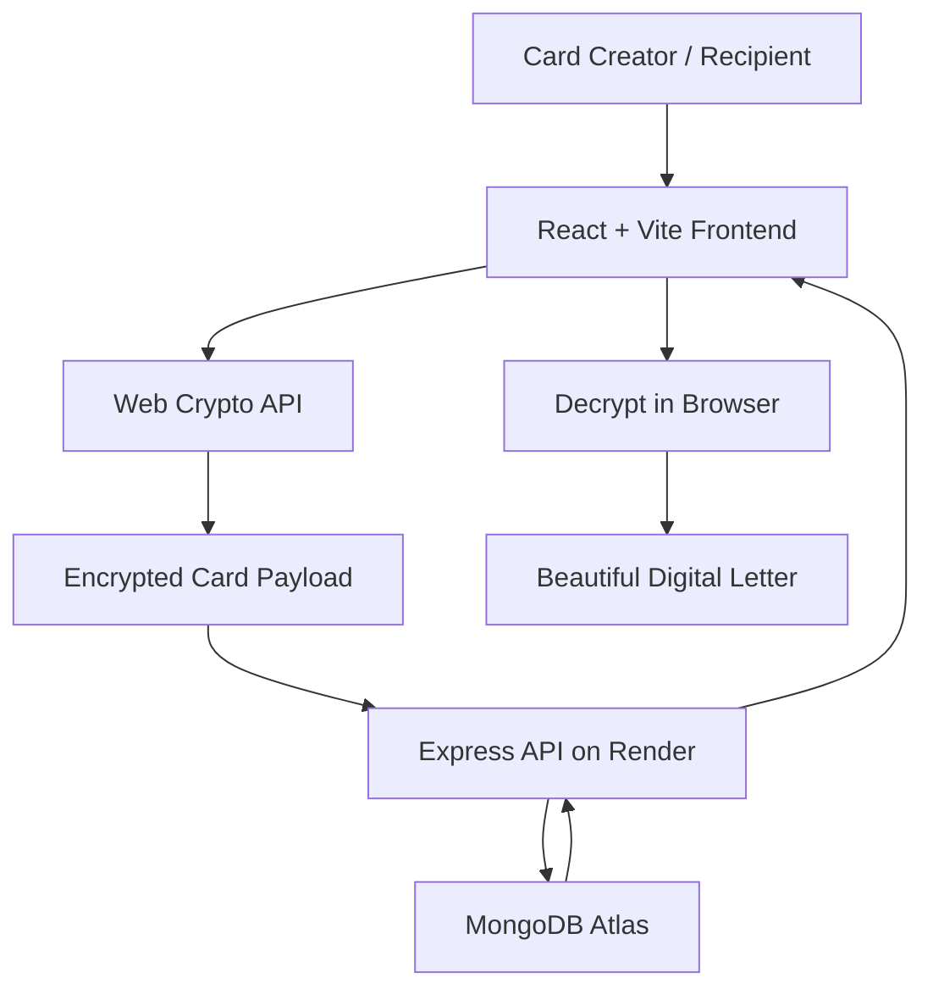

# ♡ Say It Softly

### A little note, held close.

A space for the words that are difficult to say out loud.

**Say It Softly** is a personalized digital letter platform where you can create meaningful messages for the people who matter most. Turn your thoughts into beautiful, slow-scrolling digital cards, protect them with a secret code, and share them with someone special.

Sometimes, a simple message deserves something more than a text bubble.

---

##  Features

###  Personalized Digital Letters
- Create beautiful, personalized message cards.
- Add a title, story, meaningful one-liner, and closing message.
- Each card receives a unique 12-character ID.
- Share cards through a dedicated link.

###  Privacy & Encryption
- Client-side encryption using the Web Crypto API.
- PBKDF2 with SHA-256 and 300,000 iterations for key derivation.
- AES-256-GCM authenticated encryption.
- Secret codes never leave the browser or get stored on the server.
- Messages and optional audio are encrypted before being uploaded.

###  Personal Soundtrack
- Attach a personal MP3 soundtrack to your card.
- Recipients can listen while reading the letter.
- Audio is encrypted along with the message.
- Maximum supported audio size: 8 MB.

###  Immersive Experience
- Minimal lavender and blush-inspired interface.
- Elegant Spectral typography.
- Paired glowing orbs and subtle animations.
- Slow-scrolling story presentation.
- Light and dark themes.
- Responsive design for mobile and desktop.
- Reduced-motion support.

---

##  Tech Stack

| Category | Technologies |
|---|---|
| Frontend | React 19, Vite |
| Routing | React Router |
| Backend | Node.js, Express.js |
| Database | MongoDB, Mongoose |
| Security | Web Crypto API, PBKDF2, AES-256-GCM |
| Audio | HTML Audio API |
| Hosting | Vercel, Render |
| Database Hosting | MongoDB Atlas |

---

##  Architecture

The application follows a client-server architecture.



**How it works:**

1. The creator writes a personalized message and optionally uploads an MP3.
2. The browser derives an encryption key from the creator's secret code.
3. The message and audio are encrypted using AES-256-GCM.
4. Only the encrypted payload is sent to the backend.
5. MongoDB stores the encrypted card and its metadata.
6. The recipient opens the card using its unique ID and secret code.
7. The browser retrieves and decrypts the content locally.

The backend never receives the secret code or plaintext message.

---

##  Project Structure

```text
say-it-softly/
│
├── client/
│   ├── public/
│   │   ├── logo.png
│   │   └── favicon.png
│   │
│   ├── src/
│   │   ├── components/
│   │   │   ├── MusicPlayer.jsx
│   │   │   ├── OrbPair.jsx
│   │   │   ├── SiteHeader.jsx
│   │   │   └── StoryBeat.jsx
│   │   │
│   │   ├── pages/
│   │   │   ├── Home.jsx
│   │   │   ├── CreateCard.jsx
│   │   │   ├── OpenCard.jsx
│   │   │   ├── SavedCard.jsx
│   │   │   └── Story.jsx
│   │   │
│   │   ├── utils/
│   │   │   ├── api.js
│   │   │   └── crypto.js
│   │   │
│   │   ├── App.jsx
│   │   ├── main.jsx
│   │   └── styles.css
│   │
│   ├── index.html
│   ├── vercel.json
│   └── package.json
│
├── server/
│   ├── controllers/
│   │   └── cardController.js
│   ├── models/
│   │   └── Card.js
│   ├── routes/
│   │   └── cardRoutes.js
│   ├── server.js
│   └── package.json
│
├── package.json
├── package-lock.json
└── README.md
```

---

##  Getting Started

### Prerequisites

Make sure you have the following installed:

- Node.js 18 or later
- npm
- MongoDB Atlas account or local MongoDB instance
- Git

### 1. Clone the repository

```bash
git clone https://github.com/kathrojusaikrishna/SayItSoftly.git
cd SayItSoftly
```

### 2. Install dependencies

```bash
npm install
npm install --prefix client
npm install --prefix server
```

### 3. Configure environment variables

Create a `.env` file inside the `server` directory.

```env
PORT=3000
NODE_ENV=development
MONGODB_URI=your_mongodb_connection_string
```

Never commit your actual `.env` file or database credentials.

### 4. Start the application

Run the backend:

```bash
npm run dev --prefix server
```

In another terminal, start the frontend:

```bash
npm run dev --prefix client
```

Open:

```text
http://localhost:5173
```

The Vite development server proxies `/api` requests to the Express backend.

---

##  Deployment

The application uses separate hosting services for its frontend and backend.

| Component | Platform |
|---|---|
| React frontend | Vercel |
| Express backend | Render |
| Database | MongoDB Atlas |

### Frontend — Vercel

Import the GitHub repository and configure:

| Setting | Value |
|---|---|
| Root Directory | `client` |
| Framework | Vite |
| Build Command | `npm run build` |
| Output Directory | `dist` |

Add this environment variable:

```env
VITE_API_URL=https://your-render-backend.onrender.com
```

The `client/vercel.json` rewrite configuration ensures that React Router routes work when users open shared card links directly.

### Backend — Render

Create a Node.js Web Service using the repository root.

**Build Command:**

```bash
npm install --include=dev && npm install --include=dev --prefix client && npm install --include=dev --prefix server && npm run build
```

**Start Command:**

```bash
npm start
```

Configure:

```env
NODE_ENV=production
MONGODB_URI=your_mongodb_connection_string
CLIENT_URL=https://your-vercel-domain.vercel.app
```

Allow the deployed frontend origin through the backend CORS configuration.

### Database — MongoDB Atlas

1. Create a MongoDB Atlas cluster.
2. Create a database user.
3. Configure network access for your Render service.
4. Add the MongoDB connection string to Render environment variables.

---

##  Security & Privacy

Privacy is an important part of Say It Softly.

- Encryption happens in the browser before data reaches the server.
- Secret codes are never stored in the database.
- AES-GCM provides authenticated encryption.
- A recipient needs both the card ID and secret code.
- The server stores encrypted content rather than readable messages.
- MongoDB documents use a TTL index configured to expire cards after one year.

**Important:** Lost secret codes cannot be recovered. Anyone with both a card ID and its secret code can decrypt that card.

The project currently supports card creation and retrieval, not user accounts or editing existing cards.

---

##  Why I Built This

Most conversations happen through instant messages. But some words deserve more time, a little more thought, and a space of their own.

I wanted to build something that makes sending a personal message feel meaningful again.

Not just another messaging application, but a small digital experience where words, memories, and music come together.

---

##  Creator

**Saikrishna**

Created with curiosity, a little courage, and a lot of love. ♡

---

### Made for the moments that stay.

